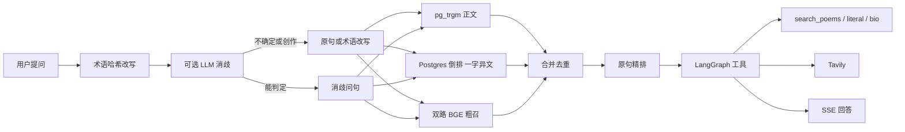
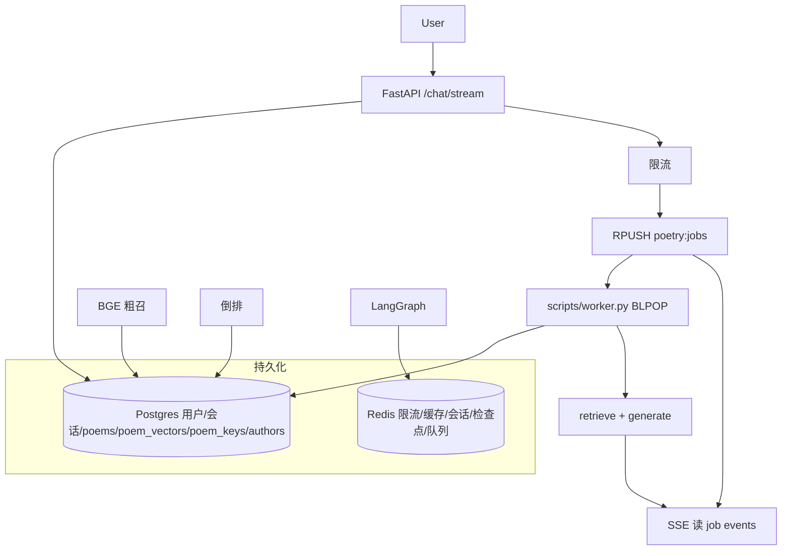

# 诗词助手（poetry-assistant）

古诗词 RAG Agent：问句经术语改写与可选消歧后，走 Postgres 倒排 / `pg_trgm` 与 BGE 向量双路粗召，BGE-Reranker 精排，由 LangGraph 选择本库工具或联网。回答经 SSE 流出。GPU 上的 retrieve / generate 由独立 worker 经 Redis 队列消费，不与 API 进程抢同一块卡。

向量模型 `BAAI/bge-large-zh-v1.5`（cosine，index v2），精排 `BAAI/bge-reranker-large`。检索算法标记 **`fts.v4`**（写入缓存 key）。诗词按篇目建向量，不做 chunk。

## 系统架构



高置信字面/倒排命中时跳过向量；多首精确命中冲突才精排。模糊问句（如 `雨霖铃意象`、`青莲居士月亮`）仍走向量 + 精排。



限流在 API 门口。worker 忙时客户端收到 `排队中…`。`gpu_max_inflight` 默认 1。

## 技术栈

| 层 | 实际用的 |
|---|---|
| API | FastAPI、JWT（python-jose / passlib）、SSE |
| Agent | LangGraph **0.2.65**，model ⇄ tools |
| 术语 | `data/terms.draft.json` 内存哈希，精确子串；线上无 NER、无模糊匹配 |
| 消歧 | Ark `json_object` + 本地 JSON Schema 校验；形状不合格最多再试 2 次，仍失败或判不了则原句。查证诗句可跳过 LLM |
| 粗召 | Postgres `poems` / `poem_keys` 倒排 + `pg_trgm` 正文 + `poem_vectors` HNSW 双路 |
| 精排 | `BAAI/bge-reranker-large` |
| 向量 | `BAAI/bge-large-zh-v1.5` cosine，检索表 `poem_vectors`（`vector(1024)` + HNSW），index v2。问句仍本地 embed；索引在 Postgres，查询路径不读 Chroma。作者简介在 `authors` 表精确按名取 |
| LLM | 火山 Ark（OpenAI 兼容 SDK + httpx `trust_env=False`） |
| 记忆 | 进模型合计约 100k token（system+摘要+原文）才压缩，压完摘要+15 条 |
| 队列 | Redis List `poetry:jobs`；worker 单独进程 |
| 配置 | pydantic-settings + `.env`（密钥）+ `config/dev.yaml`（超参） |

依赖是 pip + `requirements.txt`。Docker Compose **只起 Postgres 和 Redis**：`docker/postgres.Dockerfile` 把本地 `pgvector` 0.8.0 源码编进 `postgres:16-alpine`，镜像名 `poetry-pgvector:16`。不要 `docker compose down -v`（会清掉倒排和向量）。诗词 JSON 来自 [chinese-poetry](https://github.com/chinese-poetry/chinese-poetry)，本仓库不收录原文。

## 数据粒度

一首诗一个 document、一个向量。正文叠了异名/一作，不是 512-token overlap chunk。

分句只给 **FTS 倒排键**：按 `，。！？、；` 和换行切开，留下 **4–16 字**子句，每首最多 **20** 句，再加 5 字前缀、标题、一作异文。查询走 `poem_keys`，正文子串走 `pg_trgm`。

同长度、同二字前缀的候选做 **汉明距离 = 1**（一字异文）。正文子串走 `pg_trgm` GIN。

## 快速启动

Windows 建议 `TOKENIZERS_PARALLELISM=false`。torch **不要** `uvicorn --reload`（会复制一份 GPU 模型）。

```powershell
$env:TOKENIZERS_PARALLELISM = "false"
docker compose up -d postgres redis
copy .env.example .env
# 填 ARK_API_KEY、CHAT_MODEL、POETRY_DATA_DIR、JWT_SECRET、TAVILY_API_KEY（可空）
.\venv\Scripts\python.exe -m pip install -r requirements.txt
# GPU 轮子（本机 2.6.0+cu124）若被 PyPI CPU 轮子盖掉，再装一次：
# pip install torch==2.6.0 --index-url https://download.pytorch.org/whl/cu124
```

先下载模型再灌库。`app/config.py` 默认 `HF_HUB_OFFLINE=1`，ingest 不会现下 HuggingFace；下载脚本可走 ModelScope / hf-mirror。

```powershell
python scripts/download_embedding.py
python scripts/download_reranker.py
python scripts/ingest_poetry.py
python scripts/ingest_fts.py
# 已有 Chroma 目录、不想重算 34 万向量时：
python scripts/migrate_chroma_to_pgvector.py
```

两个进程：API 不 `--reload`，GPU 只在 **一份** worker 里跑（宿主机和 compose worker 不要同时开）。

```powershell
# 终端 1
uvicorn app.main:app --host 127.0.0.1 --port 8000
# 终端 2
python scripts/worker.py
# 或 python -m app.worker
```

编排形态（镜像含 torch，很大；本机 GPU 演示仍用上面两个终端）：

```powershell
docker compose --profile app up -d
```

```powershell
curl http://127.0.0.1:8000/health
python scripts/test_stream.py --email 你的邮箱 --password 你的密码 --q 雨霖铃的意象
pytest tests -q
```

`GET /health` 应看到 `"status": "ok"`、`"redis": true`、`index_version`（v2）、`fts_poems`、`vector_poems`、`queue`。`vector_poems` 为 0 说明还没跑迁移，倒排仍可用、向量路为空。Redis 不可用时 API 在本进程同步跑图。Redis 正常但没起 worker 时，SSE 等到 `job_wait_seconds`（默认 180s）后报错。

## 目录

```
poetry-assistant/
├── README.md
├── requirements.txt
├── docker-compose.yml          # 默认只 postgres + redis
├── docker/postgres.Dockerfile  # postgres:16-alpine + 本地 pgvector 0.8.0
├── Dockerfile                  # 可选 worker；含 torch，体积很大
├── .env.example
├── config/dev.yaml
├── config/prod.yaml
├── app/
│   ├── main.py
│   ├── config.py
│   ├── db.py
│   ├── observability.py
│   ├── eval_metrics.py
│   ├── chat_eval.py            # 对话规则打分，不是 P@5
│   ├── worker.py
│   ├── api/                    # auth / chat / conversations
│   ├── models/                 # user / conversation / message / poem+poem_keys / author
│   ├── schemas/
│   └── services/
│       ├── terms.py            # 内存术语
│       ├── disambiguate.py
│       ├── query_span.py
│       ├── poetry_parse.py     # 分句 4–16、max 20；向量/倒排共用
│       ├── fts.py / fts_ingest.py / line_index.py
│       ├── rag.py              # 问句 embed + 调 pgvector / authors
│       ├── vector_store.py     # poem_vectors + HNSW；查询不读 Chroma
│       ├── chroma_migrate.py   # 一次性从旧 Chroma 拷到 poem_vectors
│       ├── retrieve.py         # fts.v4
│       ├── rerank.py
│       ├── graph.py / tools.py / chat_run.py
│       ├── job_queue.py / redis_store.py / checkpoint.py
│       ├── llm.py              # Ark；volces.com 优先 IPv4
│       ├── memory.py / web_search.py / security.py
│       └── author_aliases.py
├── dataset/
│   ├── eval.jsonl              # 检索主集 42
│   ├── eval_extra.jsonl        # 扩集 156，合计 198
│   └── chat_eval.jsonl         # 对话评测 20
├── tests/
├── scripts/
│   ├── ingest_poetry.py
│   ├── ingest_fts.py
│   ├── migrate_chroma_to_pgvector.py
│   ├── download_embedding.py
│   ├── download_reranker.py
│   ├── worker.py
│   ├── eval_rag.py
│   ├── eval_chat.py
│   ├── test_stream.py / test_retrieve.py
│   ├── load_terms.py
│   └── extract_terms_ner.py    # 离线 NER，线上不用
└── data/terms.draft.json
```

旧 Chroma 目录（只给迁移脚本读）、`.env`、评测落盘与 NER 中间产物已进 `.gitignore`。Windows 上 `scripts/` 和 `Scripts/` 是同一目录。

## 检索与 Agent 链路

1. **术语改写**：整句转简体，术语表面最长优先精确命中。`放翁是谁` → `陆游（放翁）是谁`。打错字不会中。作者别称从简介抽取「字/号/居士」叠进术语表。
2. **LLM 消歧（可选）**：如 `雨霖铃` 的词牌 / 乐曲 / 诗句。调用带 `response_format=json_object`，回来按固定 schema 校验（字段齐全、intent 枚举）。不合格最多再试 2 次，超了或不确定/创作则不改写。查证诗句（含「下一句/出处/哪首/谁写的」且不少于 4 字连续汉字，或剥壳后本身是 4–16 字句）跳过消歧 LLM；跳过结果仍写入 `poetry:dis:`。
3. **字面 + 倒排 + 双路 + 重排（`fts.v4`）**：套话剥离后走 Postgres。`poem_keys` 存全文各句 + 5 字前缀 + 标题 + 一作。正文子串 `pg_trgm`。
   - 字面/倒排已有高置信诗句命中 → 跳过向量粗召。
   - 多首精确命中冲突才精排；只有一首则直接保送。
   - 模糊问句仍走向量 + 精排。
   - rerank 分低于 **`VECTOR_KEEP_MIN=0.22`** 的向量召回不占 TopK。
   - 查询 `hnsw.ef_search=64`，改这个不用重灌向量。
   - 汉明距离 1 收一字异文。
   - 回答里【主出处】只给 **rerank ≥ 0.35** 的（没有则只留第一条）。
   - 缓存 key 带 `index_version` + `fts.v4`。检索规则不写死评估集篇名。
4. **Agent 工具上限**：本库 `search_poems` / `search_poems_literal` / `get_author_bio` **每种每轮最多 1 次**（合计最多 3 次本库），`search_web` **每轮最多 2 次**。超限不执行、只根据已有结果作答。未调用本库工具时，生成后再剥掉伪装的 `【主出处】` / `【参考】` / `[作者·标题]`。库外篇目可凭记忆答，但须说明不是本库检索。
5. **记忆**：system+摘要+原文合计粗算超过 10 万 token 压一次，压完摘要+最近 15 条。摘要在 `conversations.summary`。LangGraph 检查点只存当次 model⇄tools 图状态。
6. **队列**：`gpu_max_inflight` 默认 1。会话写入用户原文，查询时再转简体。

## 评估

```powershell
python scripts/eval_rag.py --k 5 --skip-llm --no-extra
python scripts/eval_rag.py --k 5 --skip-llm
python scripts/eval_rag.py --k 5
python scripts/eval_chat.py
pytest tests -q
```

三档对比：`raw`（只向量）/ `terms`（术语改写后向量）/ `full`（改写 + 可选消歧 + 字面 + 双路 + 精排）。`--skip-llm` 不做消歧。`--no-extra` 只跑主集 42 条；默认拼上 `eval_extra.jsonl` 到 198。

评测集偏名篇。召回按作品：正文对上 gold 诗句即算找回（朱斌《登楼》与王之涣《登鹳雀楼》算同一首）。精确率：有篇名时必须标题或 ≥4 字诗句对上，短词「明月」不算。检索代码不读 `eval.jsonl`。

本机 2026-10-14，`K=5`。库规模 344899 首（去重 993），`poem_keys` 4499496。代码标记 `fts.v4`（高置信命中可跳过向量）；表中 skip-llm 数字测于其前一版 **fts.v3 全句倒排**。

主集 42 条（`--skip-llm --no-extra`）：

| mode | P@5 | R@5 | F1 |
|---|---|---|---|
| raw | 0.224 | 0.476 | 0.305 |
| terms | 0.224 | 0.476 | 0.305 |
| **full** | **0.452** | **0.869** | **0.594** |

扩集 198 条（主集 42 + extra 156，`--skip-llm`）：

| mode | P@5 | R@5 | F1 |
|---|---|---|---|
| raw | 0.134 | 0.323 | 0.190 |
| terms | 0.132 | 0.313 | 0.186 |
| **full** | **0.426** | **0.896** | **0.577** |

这 42/198 条上术语改写几乎不加分；LLM 消歧在主集上也几乎未改问句。相对 raw，full 的召回主要来自字面/倒排/精排。未单独测 P@1。

对话评测 `python scripts/eval_chat.py`：`dataset/chat_eval.jsonl` 20 条口吻问句，走术语 + 消歧 + LangGraph（不走 HTTP 队列）。规则检查金标是否出现、该不该检索、闲聊是否假引用。会调大模型，不是轻量单测。跑完写入 `dataset/chat_eval_last.jsonl`（已 gitignore）。

本机 2026-10-14，自制规则 **20/20 PASS**。这不是检索 P@5，过关不等于权威出处。Windows 上 Ark 需优先 IPv4，否则会 Connection error。

## Redis

| 前缀 | 用途 |
|---|---|
| `poetry:rl:chat:` | 对话限流 |
| `poetry:rl:login:` | 登录 IP 限流 |
| `poetry:term:` / `poetry:dis:` / `poetry:ret:` | 术语/消歧/检索缓存（ret 的 key 含 `fts.v4`） |
| `poetry:login:fail:` | 登录锁定 |
| `poetry:sess:` / `poetry:jwt:bl:` | 滑动会话、登出黑名单 |
| `poetry:lg:ckpt:` | LangGraph 检查点 |
| `poetry:jobs` | 对话任务 List（RPUSH / BLPOP） |
| `poetry:job:{id}` | 任务元数据（queued/running/done） |
| `poetry:job:{id}:events` | 该任务 token/status 的 Stream |

一直活跃会续 Redis 会话；JWT 硬上限默认 24h，快到期时响应头 `X-Access-Token`。

## 异步队列

限流在 API 门口（`poetry:rl:chat:`）。队列在 FastAPI 接住请求之后、GPU 重的 retrieve/generate 之前。SSE 仍挂在 `/chat/stream` 上读 worker 事件。

BGE embed / reranker 占 GPU。向量索引在 Postgres `poem_vectors`（HNSW，`hnsw.ef_search` 默认 64），API 多进程只打 SQL，不再每人载一份嵌入式 HNSW。问句仍要 embed，所以 GPU 只放在一份 worker 里，默认 `gpu_max_inflight=1` 串行。`uvicorn --reload` 仍会复制一份模型、抢卡。查询路径不读 Chroma。

```powershell
# 终端 1 —— 不要 --reload
uvicorn app.main:app --host 127.0.0.1 --port 8000
# 终端 2
python scripts/worker.py
```

## 配置

密钥只放 `.env`：`ARK_API_KEY`、`CHAT_MODEL`、`JWT_SECRET`、`DATABASE_URL`、`TAVILY_API_KEY`、`POETRY_DATA_DIR` 等。见 `.env.example`。

检索/记忆/队列超参在 `config/dev.yaml`（`APP_CONFIG` 可改成 `config/prod.yaml`），也可用同名环境变量覆盖：

| 项 | 默认 | 作用 |
|---|---|---|
| `retrieve_top_k` | 5 | 最终 TopK |
| `recall_k` | 15 | 倒排/向量粗召条数 |
| `hnsw_search_ef` | 64 | pgvector `hnsw.ef_search`，改它不用重灌 |
| `poem_distance_max` | 1.2 | BGE cosine 距离上限 |
| `gpu_max_inflight` | 1 | worker 同时跑 retrieve/generate 的上限 |
| `job_wait_seconds` | 180 | SSE 等 worker 的最长时间 |
| `job_ttl_seconds` | 3600 | 队列任务过期 |
| `raw_token_limit` / `keep_low` | 100000 / 15 | 记忆压缩窗口 |
| `chat_temperature` / `chat_top_p` | 0.35 / 0.9 | Agent 对话采样，略收发散 |
| `disambiguate_temperature` / `max_tokens` | 0 / 256 | 消歧 JSON |
| `summarize_temperature` / `max_tokens` | 0 / 400 | 记忆摘要 |
| `index_version` | v2 | 向量库版本，进检索缓存 key |

## 已知局限

- 术语是精确子串，没有错字/拼音纠错；线上不是 NER。
- 向量按篇目建，一首一个向量，检索走 `poem_vectors`（HNSW）。`poems.embedding` 是兼容列，查询以 `poem_vectors` 为准。
- 换 Postgres 镜像不要 `down -v`，否则倒排、向量和用户表一起没。现有 `postgres:16-alpine` 数据目录用 `docker/postgres.Dockerfile` 就地编进 pgvector，不要切到别的官方镜像硬扛同一份 data。
- 已有 Chroma 时跑 `migrate_chroma_to_pgvector.py`，按 author+title+正文 md5 对齐写入 `poem_vectors`，不重算 embedding。对不上的再用「作者+标题唯一」回填。之后查询不再打开 Chroma。
- 字面检索依赖 `python scripts/ingest_fts.py` 写入 `poems` / `poem_keys`。没灌倒排时字面/标题召回为空；`GET /health` 里 `vector_poems` 为 0 时向量路为空。
- Windows 上独立进程加载 `BAAI/bge-large-zh-v1.5` 做问句 embed，可能 `0xC0000005` 退出（rust tokenizers；`TOKENIZERS_PARALLELISM=false` 仍可能崩）。字面/倒排不依赖 BGE：本机 `床前明月光` 经一字异文命中李白《静夜思》（库内正文为「床前看月光」）。模糊问句仍需要 BGE。
- 标题异名、一作异文已写入 `document` 和 `title_aliases`。
- 术语草稿以词牌/作者为主。离线 NER 见 `scripts/extract_terms_ner.py`，未覆盖全库，线上不加载。
- Windows 上火山 Ark 常踩 IPv6：`llm.py` 对 `volces.com` 优先 A 记录，httpx `trust_env=False` 避免系统代理把 IPv6 绕回。
- 评估主集 42、扩集 156，合计 198，仍偏名篇。对话 20/20 是自制规则分，没有 P@1。
- 没有线上压测。链路耗时看日志 `poetry.trace`。
- Compose 默认只起 Postgres / Redis。`docker compose --profile app up` 会加 worker 容器（镜像含 torch，体积很大，一般是 CPU 轮）。本机 GPU 演示仍建议宿主机 uvicorn + 一份 worker，不要和容器 worker 同时开。

## 许可证

MIT
